  

# 💼 Awesome Cash Management 

  
  
  
  
  
  
  

> 🌟 **A curated list of enterprise Treasury Management Systems (TMS), Cash Flow Forecasting software, Bank Reconciliation tools, and Open-Source Cash Positioning engines.** 🌟

Whether you are a corporate treasurer managing multi-entity global liquidity, a CFO evaluating enterprise SaaS pricing, or a software engineer building self-hosted fintech systems, this directory tracks industry-leading platforms and developer-friendly open-source frameworks.

---

## 📑 Table of Contents

- [📈 Sector Overview & Market Dynamics](#-sector-overview--market-dynamics)
- [🏢 Enterprise SaaS & Hosted Platforms](#-enterprise-saas--hosted-platforms)
- [🔓 Open-Source GitHub Projects](#-open-source-github-projects)
  - [🧩 Additional Modules & Ecosystem Add-ons](#-additional-modules--ecosystem-add-ons)
- [🤝 How to Contribute](#-how-to-contribute)
- [💖 Support & Sponsorship](#-support--sponsorship)
- [📊 Star History](#-star-history)
- [⚖️ Disclaimer](#️-disclaimer)

---

## 📈 Sector Overview & Market Dynamics

The global **Cash Management System (CMS)** software and enterprise treasury solutions market is projected to reach **$21.8B – $23.5B in 2026** (growing at a compound annual rate of **~9.5%–13% CAGR**). Key growth catalysts include real-time **ISO 20022** XML payment rails, open-banking API aggregators, Basel IV regulatory liquidity stress-testing, and autonomous AI-driven cash flow forecasting.

The sector is **moderately concentrated at the top**:
- **Enterprise Core (Top Players):** A select group of enterprise giants—such as **Workday**, **FIS**, **Kyriba**, and **Coupa**—capture over 40% of multinational corporate treasury spend.
- **Fragmented Long Tail:** Despite consolidation at the high end, corporate treasury departments experience severe **banking and data fragmentation** on the ground (managing dozens of disjointed banking portals and proprietary MT940/BAI2 formats). This drives robust demand for agile mid-market tools, regional fintech innovators, and modular open-source reconciliation pipelines.

---

## 🏢 Enterprise SaaS & Hosted Platforms

A comprehensive breakdown of leading corporate cash management and treasury suites, benchmarked by company scale, transparent starting tier pricing, and evaluation parameters.

| Company / Product | 🏛️ Company Size (Revenue / Valuation) | 💵 Pricing (Starting Tier) | ⏳ Free Tier / Trial Limits | 🎯 Core Focus & Capabilities |
| :--- | :--- | :--- | :--- | :--- |
| **[Workday Cash Management](https://www.workday.com/)** | **~$50B – $55B Market Cap** (~$10.15B ARR) | From ~$100,000/yr (bundled PEPM contract; typically starts around $100–$150/user/yr PEPM with enterprise suite minimums) | No free tier; demo sandbox provided on guided pre-sales basis (no self-service free trial days) | Cash management integrated directly within Workday Financial Management for global liquidity and accounting consolidation. |
| **[FIS Quantum](https://www.fisglobal.com/)** | **~$18B – $20B Market Cap** (~$10.7B+ ARR) | From ~$100,000/yr (enterprise base platform license plus per-seat and bank connectivity units) | No free tier; sandbox environments restricted to custom RFP/enterprise PoC engagements | Enterprise treasury and risk management suite (Quantum Cloud Edition) featuring a Liquidity Hub module for real-time multi-bank cash positioning. |
| **[Coupa Treasury](https://www.coupa.com/)** | **~$8.0B Valuation** (~$800M+ ARR) | From ~$50,000/yr (modular base tier starting at ~$50/user/month with annual suite commitments scaling to $150,000+) | No free tier; guided evaluations through pre-sales sandbox demos only | Treasury and cash management within Coupa Business Spend Management suite with dedicated Treasury REST APIs. |
| **[HighRadius](https://www.highradius.com/)** | **~$3.1B Valuation** (~$150M–$300M ARR) | From ~$50,000/yr (entry-level Autonomous Treasury / Cash Flow module subscription) | No free tier; sales-managed PoC sandbox with sample ledger data (no open free trial days) | AI-powered cash forecasting and autonomous treasury management with continuous variance auto-explanation and touchless operations. |
| **[Kyriba](https://www.kyriba.com/)** | **~$3.0B Valuation** (~$300M+ ARR) | From ~$50,000/yr (Kyriba Essentials package for mid-market; enterprise suites range $120,000+ to $350,000+/yr) | No free tier; sales-led demo and custom PoC evaluation (no self-serve free trial days) | Cloud-native enterprise treasury & cash management platform featuring agentic AI forecasting, liquidity positioning, and multi-bank connectivity. |
| **[GTreasury](https://www.gtreasury.com/)** | **~$1.0B Valuation** (Acquired by Ripple) | From ~$40,000/yr (base modular treasury tier for cash positioning and reconciliation) | No free tier; structured 14-to-30 day guided proof-of-concept for qualified prospects | Modular treasury and cash management platform covering cash visibility, forecasting, debt, investments, and cross-border payments. |
| **[Agicap](https://agicap.com/)** | **~$805M Valuation** (~$45M ARR) | From ~$150/mo billed annually (~$1,800/yr for starter SMB cash tracking; scaling to $800+/mo for multi-entity) | Up to 14-day free trial arranged via sales onboarding with live bank synchronization testing | SMB and mid-market cash flow forecasting and liquidity management with automated multi-bank statement synchronization. |
| **[Serrala](https://www.serrala.com/)** | **~$600M – $800M Est. Value** (PE-backed by Hg/Waterland) | From ~$120,000/yr (baseline cloud/SAP-embedded enterprise cash automation license) | No free tier; custom pre-production sandbox for SAP architecture evaluations only | Unified inbound/outbound payments, cash visibility, and automated cash application running native or embedded in SAP S/4HANA. |
| **[TIS (Treasury Intelligence Solutions)](https://www.tis.com/)** | **~$300M – $500M Est. Value** (~$35M–$48M ARR; Marlin Equity) | From ~$24,000/yr (CashOptix cloud starter package based on bank account connectivity units) | No free tier; structured technical PoC for qualified enterprise treasury teams | Cloud-native multi-bank connectivity, payments intelligence, and enterprise liquidity optimization. |
| **[Nomentia](https://www.nomentia.com/)** | **~$100M – $200M Est. Value** (€10M–€50M ARR; PSG Equity) | From ~$15,000/yr (modular Cash Management & Liquidity starter package) | No free tier; custom demonstration and pilot sandbox configured per ERP setup | European cash management, in-house banking, deal handling, payments oversight, and multi-bank communication. |

---

## 🔓 Open-Source GitHub Projects

Curated open-source repositories for self-hosted cash flow visibility, programmatic bank statement reconciliation, financial ledgers, and automated liquidity modeling. Sorted descending by GitHub star count.

| Project | ⭐ Stars | 🛠️ Tech Stack | 📜 License | 💡 Description & Features |
| :--- | :--- | :--- | :--- | :--- |
| **[Firefly III](https://github.com/firefly-iii/firefly-iii)** |  | PHP (Laravel) | AGPL-3.0 | Self-hosted financial manager supporting multi-bank account tracking, cash flow rules, double-entry ledgers, and liquidity monitoring. |
| **[Apache Fineract](https://github.com/apache/fineract)** |  | Java | Apache-2.0 | Open-source core banking platform with teller and cashier cash management, liquidity accounting, and financial portfolio management. |
| **[Money Manager Ex](https://github.com/moneymanagerex/moneymanagerex)** |  | C++ | GPL-2.0 | Cross-platform desktop cash and personal/micro-business wealth management software with cash flow forecasting and bank reconciliation. |
| **[Go-Money](https://github.com/ft-t/go-money)** |  | Go | MIT | Audit-grade double-entry financial bookkeeping engine with Lua-scriptable cash-in/cash-out automation and Grafana liquidity dashboards. |
| **[Helius Finance Tracker](https://github.com/Helius-Finance/helius-finance-tracker)** |  | Rust | MIT | Local-first financial tracking and ledger engine featuring a terminal UI, bank statement reconciliation, and cashflow forecasting. |
| **[MoneyMatter](https://github.com/letehaha/moneymatter)** |  | TypeScript / Svelte | GPL-3.0 | Self-hosted money and liquidity tracker with automated multi-currency rates, AI statement parsing, cashflow visualization, and MCP server support. |
| **[Gantry Financial Suite](https://github.com/braedonsaunders/com.flux.gantry)** |  | SuiteScript (NetSuite) | MIT | Financial analytics SuiteApp for NetSuite with rolling weekly cash flow forecasting from GL history, AP/AR aging, and bank balancing. |
| **[Moneta](https://github.com/revoltify/moneta)** |  | PHP (Laravel) | AGPL-3.0 | Self-hosted cash management and money tracking for small businesses and freelancers with 26 Model Context Protocol (MCP) tools for AI agents. |
| **[Agentic TLM](https://github.com/chrisshayan/agentic-tlm)** |  | Python | MIT | Multi-agent autonomous treasury and liquidity management system using LSTM/Transformer models for automated cash flow alignment and risk balancing. |
| **[AFIS](https://github.com/afild/AFIS)** |  | Python | MIT | Financial intelligence tool for SMEs delivering machine learning-driven 12-month rolling cash flow forecasting with confidence intervals. |
| **[Nexus\CashManagement](https://github.com/azaharizaman/nexus-cash-management)** |  | PHP | MIT | Atomic, framework-agnostic package for multi-currency bank account management, CSV statement import with duplicate detection, and cash reconciliation. |
| **[Nexus\Treasury](https://github.com/azaharizaman/nexus-treasury)** |  | PHP | MIT | Treasury governance package providing corporate authorization limits, multi-currency approval workflows, and spending thresholds. |

### 🧩 Additional Modules & Ecosystem Add-ons

- **[Odoo `finance_treasury`](https://apps.odoo.com/apps/modules/18.0/finance_treasury)** — Universal treasury management module for Odoo 18 (LGPL-3). Handles cash/bank/card/wallet accounts, income/expense/transfer transactions, and automatic journal entries.
- **[Odoo `treasury_cash_management`](https://apps.odoo.com/apps/modules/19.0/treasury_cash_management)** — Cash management add-on for Odoo 18/19 (OPL-1) featuring 13-month rolling forecasts, daily snapshots, and bank reconciliation wizards.
- **[Odoo `treasury_forecast`](https://apps.odoo.com/apps/modules/13.0/treasury_forecast)** — Treasury forecasting add-on for Odoo 13 (OPL-1) deriving daily cash flow projections from bank moves and planned payables/receivables.
- **[Eclipse Tradista](https://projects.eclipse.org/proposals/eclipse-tradista)** — Open-source trade and treasury software for financial institutions (Apache 2.0), covering cash flow forecasts and position keeping for capital market securities and derivatives.
- **[FrontAccounting](https://frontaccounting.com/)** — Web-based accounting/ERP system (GPL) with cash and bank account tracking, petty cash management, and reconciliation.

---

## 🤝 How to Contribute

Contributions are very welcome! To suggest an update, add a missing SaaS platform, or list a new open-source repository:

1. 🍴 **Fork the repository** on GitHub.
2. 🌿 **Create a new branch** (`git checkout -b feature/new-cash-management-tool`).
3. ✏️ **Add/edit entries in `README.md`** following the existing tabular structure, ensuring pricing or star counts are properly referenced.
4. 🚀 **Commit your changes** with a clear message (`git commit -m "Add ToolName to cash management list"`).
5. 📬 **Submit a Pull Request** describing the addition.

---

## 💖 Support & Sponsorship

Thank you for exploring and using **Awesome-Cash-Management**! ☕

If you find this curated fintech directory valuable for your organization, treasury research, or open-source projects, please consider supporting its continued maintenance and curation:

- 🌟 **Star the repository** to show appreciation and boost visibility on GitHub!
- 🍴 **Fork the repo** to contribute your own modules and insights!
- 📢 **Share this list** with fellow CFOs, treasurers, and fintech developers!
- ☕ **Sponsor or buy a coffee**: Support ongoing research via the [GitHub Sponsor Dashboard](https://github.com/sponsors/ishandutta2007)!

---

## 📊 Star History

---

## ⚖️ Disclaimer

- This is a **community-curated index** for informational and educational purposes — not an explicit endorsement or financial advice.
- Systems handling sensitive bank credentials, payment files, or transaction ledgers must maintain adherence to data protection standards (GDPR, CCPA, SOC 2, ISO 27001) and strict segregation of duties.
- **Distinction between Corporate Treasury vs. Small Business Tools:** Enterprise solutions like **Workday, FIS Quantum, Kyriba, GTreasury, and Coupa** are multi-entity, global payment execution platforms. Solutions like **Firefly III** or **Helius** serve personal or micro-business cash flow tracking, while packages like **Nexus** provide modular code building blocks for developers.
- **Pricing Disclosures:** Enterprise SaaS vendors quote custom fees based on entity counts, active bank integrations, and transaction volume. Starting tier estimates reflect verified buyer intelligence and third-party SaaS procurement benchmarking.

---

  Built with ❤️ for developers, finance teams, and organizations seeking transparent, data-driven cash management.

